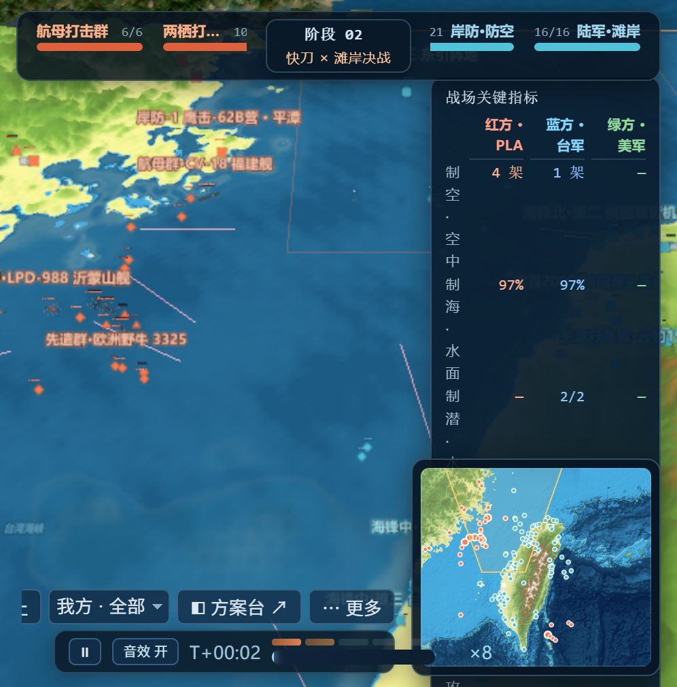
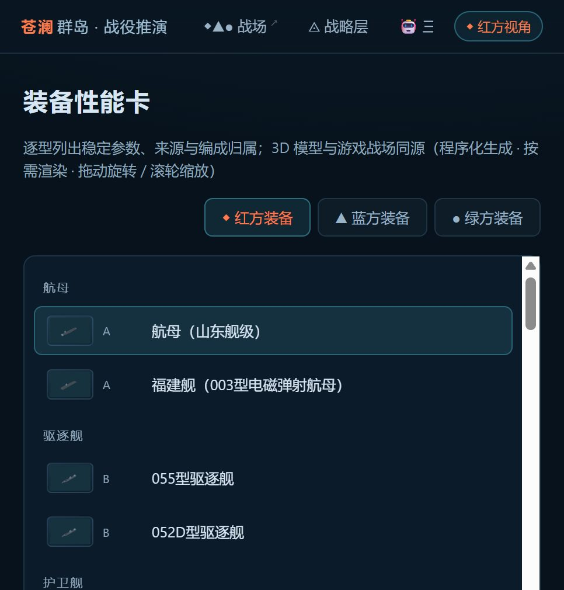

# 苍澜群岛 · Canglan Islands

**A three-sided campaign wargame that runs entirely in your browser — no build, no server, no backend.**

**Everything on screen — coastline, hulls, aircraft, missile batteries — is generated in code when the page loads. No 3D model files are ever downloaded.**

Red / Blue / Green each get a machine staff. The island chain, the fleets, the missile
defence zones and the timing windows are assembled from **open source material only**:
news reports, ministry-of-defence publications, think-tank tables, encyclopedic entries and
public bathymetric grids. What you click is a simulation, not a leak.

> **What this is** — a research / teaching / entertainment model of an amphibious
> campaign across a strait, with three adversarial staffs and a fog-of-war layer.
> **What this is not** — an official position of anyone, an operational plan, or a
> prediction of real events. See [Disclaimer](#disclaimer).

---

## Run it

**Just want to see it?** [Open the live demo →](https://canglan-wargame.app.workbuddy.host/?sharecode=H5AAFF5PHX) — no install, no account, nothing to build.

Otherwise, any static file server will do — the pages use ES modules, so `file://` will not:

```
npx serve .
```

then open `index.html` (the battlefield), `wargame.html` (the console) or `strategy.html`
(the strategic layer). No bundler, no npm install, no runtime dependencies beyond the
three.js copy vendored in `lib/`.

## What it looks like

**The battlefield** — 3D sea and terrain, live unit motion, per-seat fog of war,
contact report rail, minimap, force-timing bars along the top.



**The strategic layer** — two graphs and one chain: pre-war decision convergence and
in-war execution, with the method labels (influence diagram, MDMP / decision support
tile, branches and sequels) attached to the controls that actually implement them.


**The equipment catalogue** — every modelled type with its parameter sheet, its
confidence grade and its sources; the preview is the same build code the battlefield uses.



## The ten screens

| Page | What happens there |
|---|---|
| `index.html` | The battlefield: 3D sea-and-terrain map, real-time unit motion, first-person camera on any hull, per-seat fog of war, contact report rail, minimap |
| `wargame.html` | Three-staff run console: start a match, pick the opening scheme for each side, watch the decision log, replay any earlier moment |
| `agent.html` | The three machine staffs: each side's persona, how it reads the picture, what it is allowed to order, and the reason it attached to every order |
| `strategy.html` | Strategic layer as an interactive decision tree: our decisions vs. uncertain externals vs. derived constraints, with branches, sequels and feasibility pruning |
| `preset.html` | Pre-war configuration desk: build a side's strategic tree and tactical opening from data, then hand it to the run |
| `plan.html` | Course-of-action board: side-by-side scheme comparison with quantified estimates behind each card |
| `tactical.html` | H-Hour order of battle: task organisation, phase line, and time-stamped mission sequences per side |
| `combat.html` | Engagement rules: salvo-style exchange math, per-shot probability, damage and kill assessment — every number computed on the page |
| `fleet.html` | Order of battle browser: unit-by-unit composition, loadout, weapon fit and where each hull actually sits |
| `unit.html` | Equipment catalogue: live 3D preview of every modelled type with its parameter sheet and its sources |

## What is actually modelled

**Three adversarial staffs.** Red, Blue and Green are separate commanders with separate
senses, separate force generation and separate doctrine files. Each issues orders in the
same verb vocabulary the human player uses (`maneuver`, `engage`, `search`, `track`,
`commit_reserve`, `withdraw_axis`, `hold_fire`, …), and every order carries a one-line
intent that shows up in the decision log. You can take direct command of any of the three
sides mid-run.

**Per-seat fog of war, four levels.** A unit is *not detected*, *vaguely inferred*,
an *expired snapshot*, or *under live tracking* — for that seat only, recomputed from
that seat's sensors. The same object is live for one side and invisible for another.
Unfixed contacts are drawn as predicted-track uncertainty ellipses rather than points,
incoming munitions enter the same layer instead of magically appearing, and shared
intelligence (satellite / patrol aircraft / shore radar net) is modelled as an input to
the picture, not as an omniscient camera.

**A data-driven force model.** 43 catalogued equipment types, ~21,000 lines of hand-written
front-end code, 88 parameter entries across the three sides. Ships, aircraft, submarines,
missile launchers, harbours, reefs and islands are all **generated procedurally from
primitives at load time — the repository contains zero third-party 3D model files.**

**A six-layer data spine**, each layer with its own revision, update date and source list:

| Layer | File | Holds |
|---|---|---|
| L1 | `data/L1_static.json` | Equipment catalogue: identity, dimensions, displacement, crew, class |
| L2 | `data/L2_params.json`, `L2_blue_params.json`, `L2_green_params.json` | Performance per side: speed, range, magazine depth, sensor and weapon envelopes |
| L3 | `data/L3_combat.json` | The engagement model itself: exchange math, damage functions, kill criteria |
| L4 | `data/L4_basing.json`, `L4_blue_denial.json`, `L4_green_ops.json`, `L4_schemes.json`, `L4_strategy.json` | Where forces actually are, how they group, and the selectable courses of action |
| L5 | `data/L5_strategy_ops.json` | Strategic decision trees: variables, branches, sequels, interaction rules |
| L6 | `data/L6_tactical.json` | H-Hour orders of battle and phase plans derived from L4 × L5 |

Two rules govern that spine. **One value, one home**: a number lives in exactly one layer
and everything else reads it — there is no second copy to drift. **No source, no entry**:
a basing site is only instantiated in the engine if at least one traceable public
reference puts that force there; unsourced candidates are demoted to relative manoeuvre
positions and never drawn as fact. Every record carries a confidence grade
(`A` / `B` / `C`) and an `updated` date, and contested readings are written down as
adjudications, not silently resolved — 22 of them in the current basing registry.

**Scale is a single system**, not a set of magic numbers: one world-unit definition feeds
terrain sampling, model sizing, label scaling, sensor ranges and movement, so a 185 km
engagement circle means the same distance on the map, in the minimap and in the engine.

**Estimates are computed, not typed.** The course-of-action board runs the L3 model in a
Monte Carlo sweep (600 sample runs per estimate) and reports an interval, not a promise;
the coefficients come from the same public parameter layers as everything else.

## Method lineage

The engagement math follows the openly published salvo-model tradition
([Hughes' modified salvo model](https://doi.org/10.1287/opre.1040.0195);
[an open analysis of small navy tactics using it](https://upload.wikimedia.org/wikipedia/commons/1/1c/An_analysis_of_small_navy_tactics_using_a_modified_Hughes%27_Salvo_Model_%28IA_annalysisofsmall109453615%29.pdf)),
the strategic layer borrows the structure of US military decision-making process practice
(decision support tiles, decision points and missions, branches and sequels), the tactical
layer uses task-organisation + H-Hour sequence + five-paragraph order form, and the
force-on-terrain work sits in the public wargaming-and-simulation literature
([INFORMS simulation proceedings paper](https://www.informs-sim.org/wsc19papers/238.pdf),
[Naval Postgraduate School chapter](https://nps.edu/documents/105988579/106076845/ch6.pdf)).
Nothing here is secret methodology — it is public methodology applied to public data, in a browser.

## Data and attribution

- **[DATA_SOURCES.md](DATA_SOURCES.md)** — where every number came from, the confidence
  scale, and how to check or replace one.
- **[NOTICE.md](NOTICE.md)** — third-party code and open data grids used, with their terms.
- **[ROADMAP.md](ROADMAP.md)** / **[ROADMAP.zh-CN.md](ROADMAP.zh-CN.md)** — where this is going.

## Language

The interface is written in Chinese. A Chinese edition of this README lives beside it:
**[README.zh-CN.md](README.zh-CN.md)**. English interface strings are on the roadmap.

## Disclaimer

This project is a **simulation and a study aid for public-material analysis and
entertainment**. It is not, and must not be presented as: an official document, a
military planning product, intelligence assessment, or a forecast of real events.
All force dispositions are reconstructions from **open, publicly available sources**
as of the dates recorded in the data files; sources can be wrong, and the confidence
grade on each record is the honest answer about how much to trust it. The project
represents no government, military organisation, employer or community. It contains no
classified, restricted or non-public information of any kind. Names of real equipment,
units and places are used only to describe what is publicly known about them; including
something in the model is not an endorsement of any claim about it.

## License

Code and text: MIT — see [LICENSE](LICENSE).
Third-party components and open data grids: see [NOTICE.md](NOTICE.md).
Terrain elevation and bathymetry are derived from public grids; the data files themselves
are research reconstructions from public reporting and remain under the terms described
in [DATA_SOURCES.md](DATA_SOURCES.md).
