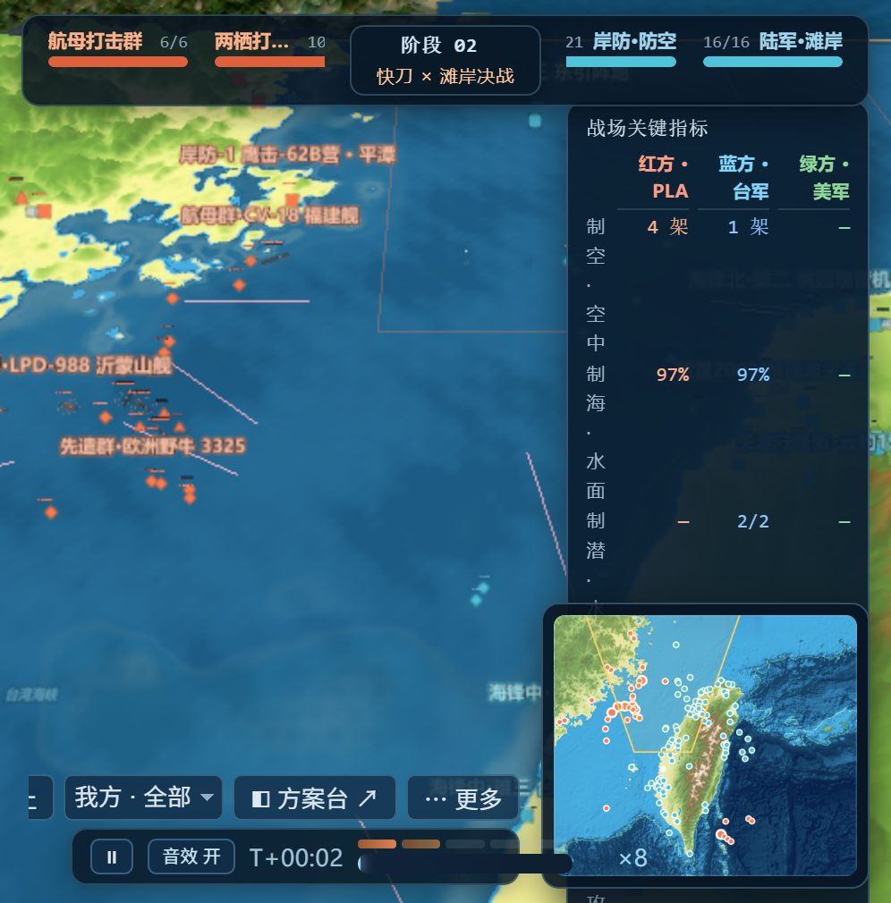
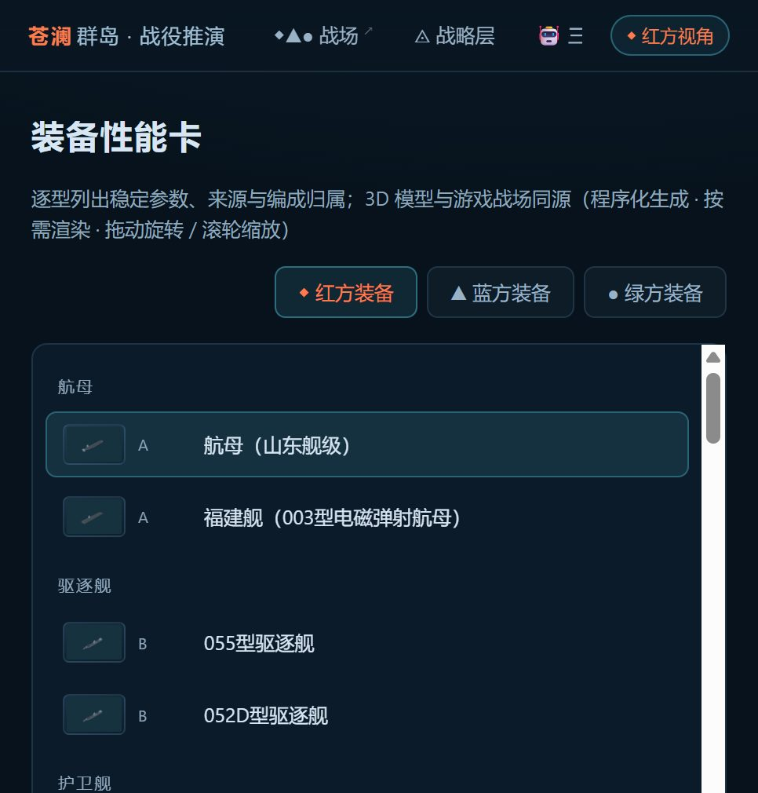

# 苍澜群岛 · Canglan Islands

**一个跑在浏览器里的三方战役推演：红 / 蓝 / 绿各有自己的参谋部，也各有自己的一张战场图。** 按席位计算的四级战争迷雾，让同一个目标在一方眼里是实时跟踪、在另一方眼里可以根本不存在；推演中随时接管任意一方，每道命令都带理由进决策日志，还能回到任意时刻重看。

**十个页面连成一条链**：战前配置、方案量化对比、3D 战场、战后复盘。海面、舰体、飞机、导弹阵地都在打开页面时用代码现场生成；每条记录都带着出处与可信度分级。

红方 / 蓝方 / 绿方各有一个机器参谋部。岛链、舰队、导弹防区与时间窗口，全部由**公开资料**
拼装而成：新闻报道、防务部门公开出版物、智库表格、百科条目、公开海洋测深格网。
你在这里点到的是仿真，不是泄露。

> **它是什么** —— 一个跨海峡登陆战役的研究 / 教学 / 娱乐模型，带三个对抗参谋部和一层战争迷雾。
> **它不是什么** —— 不是任何一方的官方立场，不是作战计划，也不是对真实事件的预测。见 [免责声明](#免责声明)。

---

## 打开方式

**只想先看一眼？** [打开在线演示 →](https://canglan-wargame.app.workbuddy.host/?sharecode=H5AAFF5PHX) —— 不用装东西、不用注册，浏览器直接开。

想自己在本地跑，任意静态文件服务器都可以 —— 页面用的是 ES module，直接双击 `file://` 打不开：

```
npx serve .
```

然后打开 `index.html`（战场）、`wargame.html`（推演控制台）或 `strategy.html`（战略层）。
没有打包器、没有 npm install，除了 `lib/` 里自带的 three.js 之外没有任何运行时依赖。

## 长什么样

**战场** —— 3D 海面与地形、单位实时机动、按席位的战争迷雾、接触报告栏、小地图、
顶部的兵力与时间窗口条。



**战略层** —— 两张图一条链：战前决策收敛与战时执行应变，方法名（影响图、MDMP / 决策支持板、
分支与后续）就挂在真正实现它的那些控件上。


**装备图鉴** —— 每个已建型号带着自己的参数表、可信度分级与出处；预览用的就是战场上那套
生成代码。



## 十个页面

| 页面 | 在这里做什么 |
|---|---|
| `index.html` | 战场：3D 海面与地形、单位实时机动、任意舰艇的第一人称视角、按席位计算的战争迷雾、接触报告栏、小地图 |
| `wargame.html` | 三方参谋部开局控制台：起一局、为每方选择开局方案、看决策日志、回到任意时刻重看 |
| `agent.html` | 三个机器参谋部：每方的决心画像、它怎么读战场、它被允许下什么令、以及它下一道令时附的理由 |
| `strategy.html` | 战略层交互决策树：我方决心 / 不确定外部 / 派生约束，含分支、后续与可行性剪枝 |
| `preset.html` | 战前配置台：用数据搭出一方的战略树与战术开局，然后交给推演 |
| `plan.html` | 方案对比板：并排比较 Courses of Action，每张卡背后都有量化预估 |
| `tactical.html` | H 时编成表：任务编组、阶段线、每方带时间戳的Mission序列 |
| `combat.html` | 交战规则：齐射式交换数学、单发毁伤概率、损伤与判定 —— 页面上每个数都是当场算出来的 |
| `fleet.html` | 编成浏览器：逐单位看编成、装载、武器配置，以及这艘船真实停在哪个点位 |
| `unit.html` | 装备图鉴：每个已建模型号都有实时 3D 预览、参数表和它的出处 |

## 到底建模了什么

**三个对抗参谋部。** 红、蓝、绿是三个各自有传感器、各自生成兵力、各自有决心文件的指挥官。
它们下的令和人类玩家用的是同一套动词表（`maneuver`、`engage`、`search`、`track`、
`commit_reserve`、`withdraw_axis`、`hold_fire` …），每道令都带一句意图，直接进决策日志。
推演中途你可以亲自接管任意一方的指挥权。

**按席位计算的战争迷雾，四个档位。** 一个单位对某个席位而言，要么*未探测*、要么*模糊推定*、
要么*过期快照*、要么*实时跟踪* —— 只针对这个席位、只用这个席位自己的传感器重算。
同一个目标在一方眼里是实时的，在另一方眼里可以完全不存在。未被固定的接触画成预测航迹的
不确定椭圆而不是一个点；来袭弹药也走同一层情报，不会凭空出现在屏幕上；
共享情报（卫星 / 巡逻机 / 岸基雷达网）是作为**输入**进入战场画像的，不是一台全知相机。

**数据驱动的兵力模型。** 43 个已建模装备型号、约 21,000 行手写前端代码、三方合计 88 条参数记录。
舰船、飞机、潜艇、导弹发射车、港口、礁石与岛屿**全部在加载时由图元程序化生成 ——
仓库里没有任何第三方 3D 模型文件。**

**六层数据主干**，每层都有自己的版本、更新日期与出处清单：

| 层 | 文件 | 装什么 |
|---|---|---|
| L1 | `data/L1_static.json` | 装备目录：身份、尺度、排水量、编制人数、级别 |
| L2 | `data/L2_params.json`、`L2_blue_params.json`、`L2_green_params.json` | 各方性能：航速、航程、弹药基数、传感器与武器包线 |
| L3 | `data/L3_combat.json` | 交战模型本身：交换数学、损伤函数、判定条件 |
| L4 | `data/L4_basing.json`、`L4_blue_denial.json`、`L4_green_ops.json`、`L4_schemes.json`、`L4_strategy.json` | 兵力实际在哪、怎么编组、以及可选择的行动方案 |
| L5 | `data/L5_strategy_ops.json` | 战略决策树：变量、分支、后续、相互作用规则 |
| L6 | `data/L6_tactical.json` | 由 L4 × L5 派生出的 H 时编成与阶段计划 |

这套主干受两条规则约束。**一个值只住一个家**：一个数只存在于某一层，其他地方都去读它 ——
不存在第二份会各自漂移的副本。**无源不入库**：只有当至少一条可追溯的公开出处把这个部队
放在那里时，这个点位才会在引擎里被实体化；没有出处的候选只降级成相对机动位置，
永远不会被画成事实。每条记录都带一个可信度分级（`A` / `B` / `C`）和一个 `updated` 日期，
读法有分歧的会作为「裁决」写下来，而不是悄悄选一个 —— 当前部署登记表里有 22 条这样的裁决。

**尺度是一整套系统，不是一堆魔术数字**：一个世界单位定义同时供给地形采样、模型尺寸、
标注缩放、传感器距离与机动速度，所以「185 km 交战圈」在大地图、小地图和引擎里是同一个距离。

**预估是算出来的，不是抄来的。** 方案对比板把 L3 模型跑一遍蒙特卡洛（每个预估 600 次采样），
报的是区间而不是承诺；系数和其余一切来自同一批公开参数层。

## 方法谱系

交战数学沿着公开发表的齐射模型传统走
（[Hughes 修正齐射模型](https://doi.org/10.1287/opre.1040.0195)、
[用它分析小型海军战术的公开论文](https://upload.wikimedia.org/wikipedia/commons/1/1c/An_analysis_of_small_navy_tactics_using_a_modified_Hughes%27_Salvo_Model_%28IA_annalysisofsmall109453615%29.pdf)），
战略层借用了美军决策流程实践的骨架（决策支持板、决策点与任务、分支与后续），
战术层用任务编组 + H 时序列 + 五段式命令格式，
兵力与地形这一部分在公开的兵棋与仿真文献里
（[INFORMS 仿真会议论文](https://www.informs-sim.org/wsc19papers/238.pdf)、
[海军研究生院章节](https://nps.edu/documents/105988579/106076845/ch6.pdf)）。
这里没有机密方法论 —— 用的是公开方法论，处理的是公开数据，跑在你的浏览器里。

## 数据与出处

- **[DATA_SOURCES.md](DATA_SOURCES.md)** —— 每个数从哪来、可信度分级怎么定、怎么自己核换。
- **[NOTICE.md](NOTICE.md)** —— 用到的第三方代码与公开格网数据，以及各自的条款。
- **[ROADMAP.md](ROADMAP.md)** / **[ROADMAP.zh-CN.md](ROADMAP.zh-CN.md)** —— 接下来往哪走。

## 语言

界面与说明书以中文为主，英文版在 **[README.md](README.md)**。
界面里的英文文案在计划中。

## 免责声明

本项目是**一个用于公开资料分析、教学与娱乐的仿真与研究辅助**。它不能被当成、也不允许被
宣传成：官方文件、军事规划产品、情报评估，或对未来事件的预测。
所有兵力部署都是**在数据文件记录的日期上、对公开资料的复原**；出处本身可能出错，
每条记录上的可信度分级就是对「该信它几分」的诚实回答。
本项目不代表任何政府、军事组织、雇主或社群。项目中不含任何涉密、受控或非公开信息。
使用真实的装备、部队与地名，只是为了描述关于它们的公开已知内容；
把某个东西放进模型，不构成对任何关于它的说法的背书。

## 许可

代码与文本：MIT —— 见 [LICENSE](LICENSE)。
第三方组件与公开格网数据：见 [NOTICE.md](NOTICE.md)。
地形高程与测深派生自公开格网；数据文件本身是对公开报道的研究复原，
适用条款见 [DATA_SOURCES.md](DATA_SOURCES.md)。
